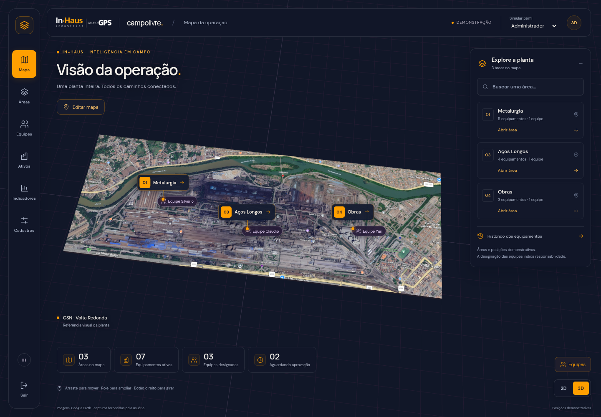
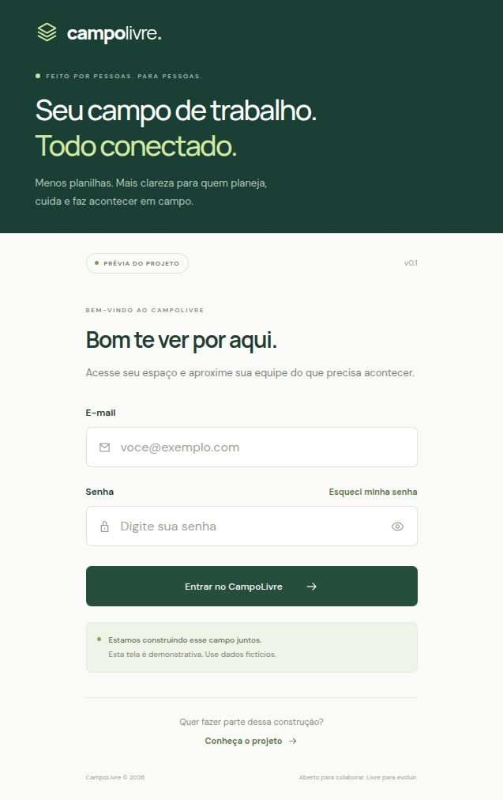

# CampoLivre

Projeto colaborativo de gestão de manutenção e equipes de campo para empresas de diferentes setores. O CampoLivre tem marca própria e não é um sistema exclusivo de uma empresa. A demonstração implementada reúne login, mapa operacional editável, cadastros locais de áreas, colaboradores e equipamentos, organização de equipes e fluxo de registro e aprovação de execuções.

Consulte o [plano do projeto](docs/plano-do-projeto.md) para distinguir o que a demonstração já apresenta dos requisitos previstos para uso operacional.

## Prévia do mapa



[Ver também a página de equipamento e seu histórico](docs/images/equipamento.png).

## Prévia do login



Interface demonstrativa. O acesso abre o hub da aplicação; não há autenticação real.

## Demonstração publicada

Acesse [campo-livre-demo.vercel.app](https://campo-livre-demo.vercel.app) e escolha **Explorar demonstração**. Para apresentar o painel, selecione o perfil **Supervisor**, abra **Indicadores** e escolha **setembro de 2026**, período dos dados demonstrativos. O perfil **Técnico / Auxiliar** permite consultar equipamentos e o histórico de manutenção.

As alterações e os registros ficam somente no armazenamento local do navegador usado na apresentação; não são sincronizados entre dispositivos. Para publicar uma atualização, execute `npm run build` e depois `vercel deploy --prod` no projeto local vinculado à Vercel. A publicação atual usa a CLI e não tem integração automática com GitHub.

A URL pública foi conferida em navegador limpo: carregamento, mapa WebGL e assets, painel de setembro com cinco registros, consulta de histórico pelo perfil Técnico / Auxiliar, recarga e layout em telas de 320 e 390 px passaram.

## Executar

Use Node.js 22.12 ou superior e npm.

```sh
npm install
npm run dev
```

Abra http://localhost:5173. Para validar a entrega:

```sh
npm run typecheck
npm run build
npm test
npm run test:e2e
```

`npm test` executa os testes do modelo. `npm run test:e2e` inicia o servidor da aplicação automaticamente e executa os testes Playwright. Instale o Chromium para Playwright com `npx playwright install chromium`, ou defina `PLAYWRIGHT_CHROMIUM_EXECUTABLE_PATH` para usar um navegador existente.

Para servir localmente a versão gerada pelo build, execute `npm run preview`.

O frontend usa React, TypeScript e [Vite](https://vite.dev/guide/). `package-lock.json` fixa as dependências; depois da instalação inicial, use `npm ci` para instalações reproduzíveis.

## Estrutura

```text
public/                 Ícone e arquivos públicos
src/
  app/                  Composição da aplicação
  components/           Componentes compartilhados
  features/auth/        Página de login e sua ilustração
  features/map/         Mapa e navegação pelas áreas
  features/operations/  Equipamentos, equipes e execuções
    model.test.mjs      Testes do modelo
  styles/               Estilos globais e responsividade
tests/                  Testes Playwright
docs/images/            Imagens de referência da demonstração
docs/                   Orientações e decisões do projeto
.scratch/campo-livre/    Histórico da entrevista e escopo
```

## Limites desta apresentação

O login tem campos demonstrativos de e-mail e senha, além da opção de explorar a demonstração sem preencher dados. Não há autenticação, contas ou backend. Recuperação de senha e participação no projeto exibem informações, sem integrações externas. As fontes vêm do Google Fonts, com fontes locais de fallback.

O mapa demonstrativo usa Three.js e WebGL, com cinco capturas de referência do Google Earth alinhadas. No desktop, use a roda do mouse para aproximar, arraste para mover, use o botão direito para girar e o seletor para alternar entre 2D e 3D. Os cartões de resumo são compactos e não há barra de botões de zoom ou rotação. No celular, o mapa abre em 2D com zoom mais próximo, navegação em menu de três linhas e enquadramento adaptado ao girar o aparelho; use arraste e pinça para explorar. A navegação leva das áreas aos equipamentos, equipes e histórico de manutenção. O mapa não é um modelo georreferenciado completo nem foi produzido por fotogrametria. As capturas da CSN servem somente como referência visual: não há vínculo institucional confirmado, piloto autorizado ou integração com dados operacionais da CSN.

Os dados simulados incluem nomes operacionais fictícios. Técnicos e Auxiliares de Manutenção podem consultar o histórico para saber o que já foi feito e ajudar a preparar os técnicos para a atividade; cargo profissional continua separado do perfil de acesso. No perfil de execução Técnico é possível registrar uma execução com descrição obrigatória e até duas fotos opcionais de 500 KB cada. No perfil Supervisor, o registro pode ser aprovado ou devolvido com motivo obrigatório. O técnico pode complementar e reenviar; os relatos anteriores permanecem no histórico. As preventivas aprovadas são filtradas pelo mês da data de execução.

A tela Indicadores está implementada para os perfis simulados Administrador, Supervisor e Líder, com filtros de mês, área e tipo, cartões por situação, evolução mensal, composição, contagens por área e acesso aos registros. Os valores usam as execuções salvas; áreas e equipamentos inativos mantêm seu histórico nos cálculos. A visão é geral e as permissões são apenas demonstrativas: não há isolamento efetivo por equipe nem autorização de servidor. Build com TypeScript, os quatro arquivos de testes do modelo (23 casos) e os 26 cenários de navegador foram validados em grupos e repetições. [Ver prévia do painel](docs/images/indicadores.png).

No perfil simulado de Administrador, a demonstração permite cadastrar, editar, filtrar, inativar e reativar áreas, colaboradores e equipamentos. Os cadastros de colaboradores distinguem cargo profissional de perfil de acesso. Em Equipes, o perfil Supervisor pode organizar a própria equipe, escolhendo colaboradores ativos e sua área designada. Administrador e Supervisor podem editar o mapa: adicionar áreas ou equipes cabe ao Administrador; o Supervisor só pode mover, remover da visualização ou restaurar o marcador da própria equipe. O Administrador pode fazer isso com os marcadores. Remover um marcador não apaga o cadastro. Essas alterações pertencem ao modelo demonstrativo local; a seleção de perfil não representa autenticação nem permissões efetivas para uso operacional.

Os fluxos usam persistência local no navegador. Os perfis da demonstração consultam o mesmo histórico nesse navegador, mas não há autenticação real, backend, sincronização ou compartilhamento multiusuário entre dispositivos. Modo automático para TV, funcionamento offline, checklists e automações com IA continuam previstos para etapas futuras.

## Colaboração

Consulte [a organização dos mantenedores](docs/governanca.md) e o [vocabulário do projeto](CONTEXT.md). O processo atual é organizado em planilhas; a direção do produto é dar ao supervisor planejamento e acompanhamento e ao técnico consulta e registro de execução.
